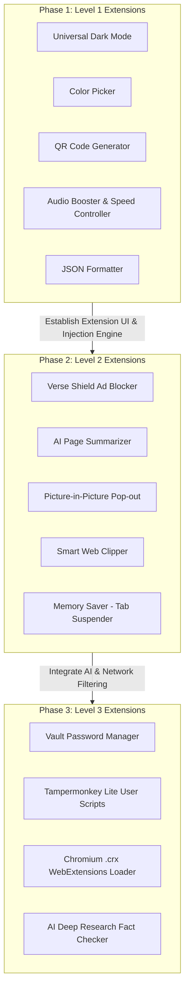

# 🧩 Verse Browser - Extensions Implementation Roadmap

This document categorizes all planned and candidate browser extensions for **Verse Browser** into 3 implementation difficulty levels based on technical complexity, required Electron APIs, state management, and security architecture.

---

## 🟢 Level 1: Low Difficulty (Easy / Quick Wins)
*Features relying primarily on standard Web APIs, basic CSS/JS injection, React UI components, or straightforward Electron IPC handlers.*

| Extension Name | Description | Key Technical Mechanism |
| :--- | :--- | :--- |
| **1. Color Auto-Picker & Eyedropper** | Click any pixel on the web screen to sample and copy HEX/RGB/HSL color codes. | Native `EyeDropper` web API or screen canvas sampling in Electron. |
| **2. Universal Dark Mode** | Inverts bright web pages and applies custom dark styling across all domains. | Dynamic CSS injection via `webContents.insertCSS()` & media filter toggles. |
| **3. Quick QR Code Generator** | Generates an instant QR code for the active page URL for quick mobile sharing. | React UI modal utilizing `qrcode.react` package. |
| **4. Speed & Audio Booster Controller** | Boosts web audio volume up to 600% and adjusts video playback speed (0.25x – 4.0x). | DOM JS injection targeting `<video>` and `<audio>` Web Audio `GainNode`. |
| **5. Speed Reader & Bionic Reader** | Formats text with bionic bolding or clutter-free reader view for faster reading. | `@mozilla/readability` parsing with a custom overlay view. |
| **6. Custom Typography Adjuster** | Customizes font family, size, line-height, and contrast per domain. | Domain-scoped CSS injection into `WebContentsView`. |
| **7. JSON Formatter & API Inspector** | Automatically formats raw JSON responses with color coding, search, and collapsible nodes. | Content-type detection & injection of a syntax-highlighted React JSON tree view. |
| **8. Inline Page Translator** | Translates foreign web page content directly into the user's preferred language. | Injection of a lightweight client translation script or Google Translate widget. |

---

## 🟡 Level 2: Medium Difficulty (Intermediate Integration)
*Features requiring state persistence, DOM selection hooks, OpenRouter LLM integration, custom window frames, or session-level request interception.*

| Extension Name | Description | Key Technical Mechanism |
| :--- | :--- | :--- |
| **9. Verse Shield (Ad & Tracker Blocker)** | Intercepts and blocks ads, analytics trackers, and malvertising before loading. | `session.webRequest.onBeforeRequest` filtering with EasyList / uBlock rules. |
| **10. Picture-in-Picture (PiP) Video Pop-out** | Detaches videos into a floating, pin-on-top, resizable frameless window. | HTML5 PiP API integration + Electron frameless `BrowserWindow` video player. |
| **11. Smart Web Clipper & Sidebar Notes** | Highlight text/images on any site and save them to a persistent note notebook. | Right-click DOM context menu selection -> IPC -> Firebase Firestore & Zustand. |
| **12. AI Web Page Summarizer** | One-click instant AI summary and bullet points of long articles and web pages. | Page text extraction (`readability`) -> OpenRouter LLM -> AI Sidebar UI. |
| **13. AI Writing & Grammar Assistant** | Floating toolbar to rewrite, fix grammar, expand, or translate selected input text. | DOM selection position detection + LLM completion API + DOM node text replacement. |
| **14. Full Page & Region Screenshot Tool** | Capture scrolling web pages or selected screen regions with cropping and markup. | `webContents.capturePage()` + canvas stitching for scrolling capture. |
| **15. Memory Saver (Auto-Tab Suspender)** | Unloads background tabs after inactivity to save RAM while preserving titles/favicons. | Tab inactivity timer in Zustand -> destroying/unloading `WebContentsView` process. |
| **16. User-Agent & Geolocation Switcher** | Spoof mobile/desktop user agents or fake GPS coordinates for site testing. | `webContents.setUserAgent()` & Electron `emulation.setGeolocation()`. |

---

## 🔴 Level 3: High Difficulty (Advanced Engine & System Architecture)
*Features requiring deep system security encryption, sandbox isolation, full Chrome WebExtensions API bridge, complex multi-agent pipelines, or low-level network proxies.*

| Extension Name | Description | Key Technical Mechanism |
| :--- | :--- | :--- |
| **17. Vault (Password Manager & Auto-fill)** | Securely store encrypted passwords and auto-fill login forms across websites. | Electron `safeStorage` OS keychain encryption + form detection content scripts. |
| **18. Privacy Sanitizer & Auto-Cleaner** | Automated session clearing of cookies, cache, and site data based on custom domain rules. | Electron `session.clearStorageData()` hooks & session partition isolation. |
| **19. HTTPS Upgrade & Safety Scanner** | Force HTTPS upgrades & actively scan URLs against malicious download databases. | `session.webRequest` redirect interception + Google Safe Browsing API hashing. |
| **20. Script & Popup Blocker Engine** | Strict control over popups, new window targets, and third-party script execution. | `webContents.setWindowOpenHandler` overrides + dynamic CSP header injection. |
| **21. AI Deep Research & Fact Checker** | Multi-agent research pipeline that verifies web statements against live search results. | Tavily search API + vector extraction + multi-pass OpenRouter LLM validation. |
| **22. Custom Script & CSS Injector (Tampermonkey Lite)** | User script manager supporting GM_* polyfills, custom triggers, and execution timing. | Isolated content script sandbox + custom GM API polyfills + script store. |
| **23. HTTP Header & Request Modifier** | Intercept, modify, or add HTTP request/response headers (e.g., CORS bypass). | Intercepting `webRequest.onBeforeSendHeaders` & `onHeadersReceived`. |
| **24. Chromium `.crx` WebExtensions Compatibility Host** | Support installing and running standard Chrome Web Extensions directly. | `session.defaultSession.loadExtension()` + extension popup action bar UI renderer. |

---

## 🚀 Recommended Phased Implementation Strategy

1. **Phase 1 (Immediate)**: Build Level 1 extensions to quickly convert the preview store into fully working native browser tools.
2. **Phase 2 (Intermediate)**: Add Ad Blocking (Verse Shield), AI Web Summarization, and Memory Saver to elevate browser performance and unique value.
3. **Phase 3 (Advanced)**: Implement encrypted Vault Password Manager, custom user script execution, and Chromium WebExtensions support.
