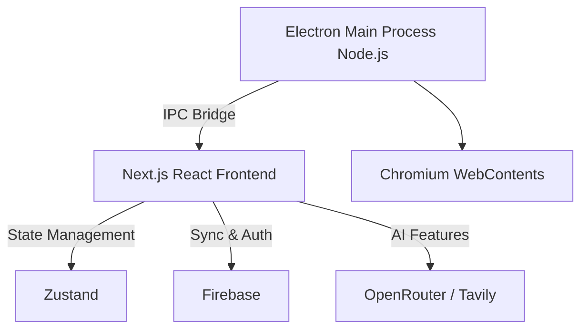

# 🌐 Verse Browser - Project Analysis Report

> [!NOTE]
> Verse Browser is a next-generation, AI-powered desktop web browser built on modern web technologies. It combines traditional web browsing capabilities with an embedded AI Sidebar, "Deep Research" capabilities, robust split-pane viewing, and cross-device Firebase syncing.

## 🛠️ Technology Stack

| Category | Technology |
| :--- | :--- |
| **Desktop Runtime** | Electron |
| **Frontend Framework** | Next.js 16 (React 19, Static Export via Turbopack) |
| **Styling** | Tailwind CSS v4 |
| **State Management** | Zustand (with persistence) |
| **Database & Auth** | Firebase (Firestore & Google Auth) |
| **Drag and Drop** | `dnd-kit` |
| **AI Integrations** | OpenRouter API (Multi-model) & Tavily (Deep research) |

## 📐 Architecture Overview

The application follows a hybrid architecture, splitting responsibilities between a Node.js main process (backend) and a React frontend.

### 🗂️ File & Folder Structure

#### Desktop Runtime (`/electron/`)
* **`main.js`**: Primary entry point. Handles app lifecycle, main windows, and IPC setup.
* **`tabManager.js`**: Manages Chromium `WebContentsView` for tabs and split-pane logic.
* **`preload.js`**: Secure IPC bridge connecting Node.js with React (`window.electron`).
* **`googleAuth.js` & `system-auth-handoff.js`**: Native Google Sign-in flow handling and handoff.
* **`profileManager.js`**: Manages isolated browsing profiles (Incognito, Multi-account).
* **`contextMenu.js`**: Generates native OS right-click context menus.
* **`windowBounds.js`**: Persists window size/position across restarts.

#### Frontend UI (`/src/`)
* **`app/`**: Next.js Routing (`layout.js`, `page.js`).
* **`components/ai/`**: AI Sidebar interface (`AISidebar.js`).
* **`components/browser/`**: Internal pages like Settings, History, and the critical `WebviewContainer.js`.
* **`components/homepage/`**: New Tab page components (Hero, TopSites, RecentTabs).
* **`components/toolbar/`**: Omnibox (`NavigationBar.js`), Tab strip (`TopBar.js`), and popup menus.
* **`store/useBrowserStore.js`**: Massive Zustand store handling tabs, history, and syncing.
* **`lib/firebase.js`**: Firebase SDK initialization.

## ✨ Key Features (Implemented)

* **Core Browsing:** Fast Chromium rendering, Omnibox navigation, Find in Page, Page Zooming.
* **Advanced Tab Management:** Drag-and-drop, tab pinning, and **Split View** (native side-by-side tabs in one window).
* **Window Proximity:** Dragging a tab creates a new window, and dragging windows near each other merges them automatically.
* **Privacy & Security:** True Incognito mode, site permissions manager, and XposedOrNot email safety checks.
* **Cloud Sync:** Multi-device sync of bookmarks, history, and AI chats via Firebase.
* **AI Assistant:** Built-in context-aware AI Sidebar with deep web research capabilities.

## 🚀 Roadmap & Pending Features

> [!WARNING]
> The following features require deep system integration and represent the most significant architectural hurdles remaining.

* **High Difficulty:** Full WebExtensions API support (installing actual `.crx` extensions), Native live translation, Active Safe Browsing API integration, Live Captions.
* **Medium Difficulty:** Password manager & Form autofill, Memory/Energy saver modes (sleeping tabs), Tab Groups.
* **UI Enhancements:** Native Cast support.

## ✅ Recent Bug Fixes
* Custom background image persistence via Base64.
* Cross-profile tab merging issues.
* Window drag resizing bug on fractional scaling displays.
* Comprehensive ARIA screen-reader support added.
