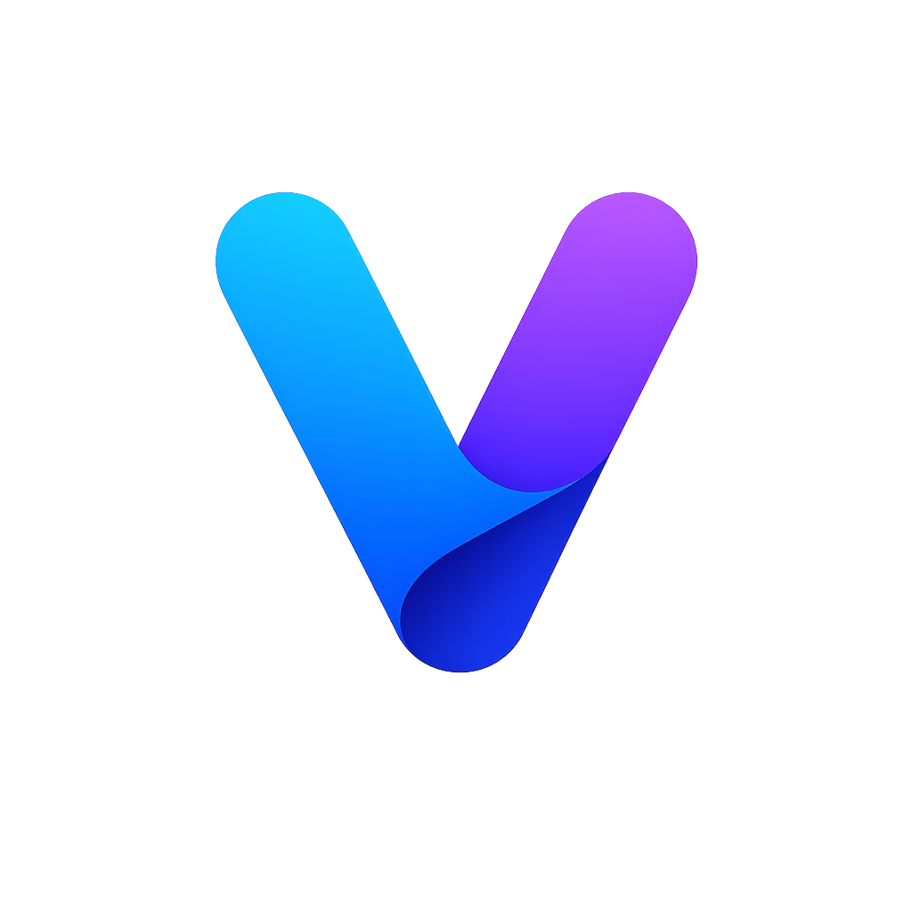

<div align="center">
  
  <h1>Verse Browser</h1>
  <p><b>The next-generation, AI-powered desktop browser built on modern web technologies.</b></p>
  
  <p>
    <a href="#about">About</a> •
    <a href="#features">Features</a> •
    <a href="#tech-stack">Tech Stack</a> •
    <a href="#getting-started">Getting Started</a> •
    <a href="#architecture">Architecture</a>
  </p>
</div>

---

## <a id="about"></a>🚀 About the Project

**Verse Browser** is a fully functional desktop web browser built from the ground up using Electron and Next.js. It aims to bridge the gap between traditional web browsing and modern AI-assistance workflows. 

Verse integrates natively with major LLMs, offering an embedded AI Sidebar, "Deep Research" capabilities, robust split-pane viewing, seamless cross-device Firebase syncing, and a sleek glassmorphic UI.

---

## <a id="features"></a>✨ Features

### Core Browsing Experience
- **Chromium Engine:** Fast and secure web rendering powered by Electron.
- **Omnibox Navigation:** Unified search and address bar with intelligent suggestions and tab switching.
- **Privacy Controls:** True Incognito Mode, safe browsing, and site permissions management.
- **Media & Utilities:** Native PDF viewing, downloads manager, find-in-page, and page zooming.

### Advanced Tab Management
- **Split View:** Natively split the viewport to view two tabs side-by-side without opening multiple windows.
- **Drag-and-Drop:** Seamlessly rearrange tabs or tear them off into new windows.
- **Tab Utilities:** Pin tabs, mute/unmute audio, duplicate, send to device, and search through open tabs effortlessly.

### Built-in Artificial Intelligence
- **AI Sidebar:** A persistent, conversational AI assistant embedded directly into your browsing workflow.
- **Multi-Model Support:** Connects via OpenRouter to seamlessly switch between Meta Llama, Google Gemini, Anthropic Claude, DeepSeek, and OpenAI models.
- **Context-Aware:** The AI can read the active tab's content to summarize, explain, or answer direct questions about the page you're viewing.
- **Deep Research Mode:** Utilizing Tavily API, the browser can autonomously search the web, analyze multiple sources, and synthesize comprehensive reports.

### Cross-Device Syncing
- **Firebase Integration:** Securely sync your bookmarks, browsing history, sent tabs, reading list, and AI chat sessions across all your devices using Google Authentication.

### UI & Customization
- **Theme Engine:** Modern Glassmorphism design with seamless light/dark mode support.
- **Customization:** Personalize your New Tab page with custom background images and dynamic widgets.
- **Distraction-Free:** Built-in Reading Mode (powered by Mozilla Readability) for extracting and cleanly formatting articles.

---

## <a id="tech-stack"></a>🛠️ Tech Stack

- **Framework:** [Next.js 16](https://nextjs.org/) (React 19)
- **Desktop Runtime:** [Electron](https://www.electronjs.org/)
- **Styling:** [Tailwind CSS v4](https://tailwindcss.com/)
- **State Management:** [Zustand](https://zustand-demo.pmnd.rs/) (with persistence)
- **Database & Auth:** [Firebase](https://firebase.google.com/) (Firestore & Google Auth)
- **Drag and Drop:** [dnd-kit](https://dndkit.com/)
- **AI Integration:** [OpenRouter API](https://openrouter.ai/) & [Tavily](https://tavily.com/)

---

## <a id="getting-started"></a>🏁 Getting Started

To get a local copy up and running, follow these simple steps.

### Prerequisites
- [Node.js](https://nodejs.org/) (v18 or higher recommended)
- `npm`, `yarn`, or `pnpm`

### Installation

1. **Clone the repository**
   ```sh
   git clone https://github.com/your-username/verse-browser.git
   cd verse-browser
   ```

2. **Install NPM packages**
   ```sh
   npm install
   ```

3. **Set up Environment Variables**
   Create a `.env.local` file in the root directory and add your API keys:
   ```env
   NEXT_PUBLIC_FIREBASE_API_KEY=your_firebase_api_key
   NEXT_PUBLIC_FIREBASE_AUTH_DOMAIN=your_firebase_auth_domain
   NEXT_PUBLIC_FIREBASE_PROJECT_ID=your_firebase_project_id
   NEXT_PUBLIC_FIREBASE_STORAGE_BUCKET=your_storage_bucket
   NEXT_PUBLIC_FIREBASE_MESSAGING_SENDER_ID=your_sender_id
   NEXT_PUBLIC_FIREBASE_APP_ID=your_app_id
   ```

4. **Run the Browser**
   To start the Next.js frontend development server and launch the Electron application simultaneously:
   ```sh
   npm run desktop
   ```

---

## <a id="architecture"></a>📂 Architecture Overview

- `/src/app` - Next.js routing and primary entry points.
- `/src/components` - React UI components (Toolbar, Sidebar, Homepage, Webview Containers).
- `/src/store` - Zustand state stores (`useBrowserStore.js`).
- `/electron` - Electron main process scripts (`main.js`, `tabManager.js`, `preload.js`).
- `/public` - Static assets and icons.

---

## 🤝 Contributing

Contributions are what make the open-source community such an amazing place to learn, inspire, and create. Any contributions you make are **greatly appreciated**.

1. Fork the Project
2. Create your Feature Branch (`git checkout -b feature/AmazingFeature`)
3. Commit your Changes (`git commit -m 'Add some AmazingFeature'`)
4. Push to the Branch (`git push origin feature/AmazingFeature`)
5. Open a Pull Request

---

## 📄 License

Distributed under the MIT License. See `LICENSE` for more information.
